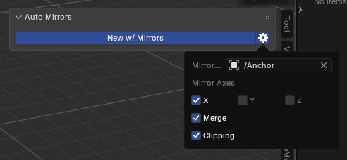

> [!CAUTION]  
> This was coded with AI help. it should be used for personal purposes.
> This is just form warmup & understanding. Pleasw wait for my upcoming general auto generated mesh with appiled addon or stack of some addons!

# Blender Addon: Automatic Add Mirrors Addons
---
yeah i annoyed to add modifier for every new object (or you can just duplicate it). but something i want the shortest way as possible to work fast. so i just make this.

## Documentation
---
You can find the addon on N-Panel.

  

1. **Mirror Anchor** : for object act as point of mirror or anchor.
2. **Axis** : you know.
3. **Merge** : merge clipping vert. best way use with clipping
4. **Clipping** : prevent vert overlap the axis.